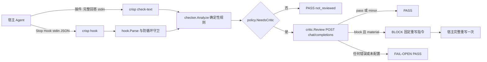
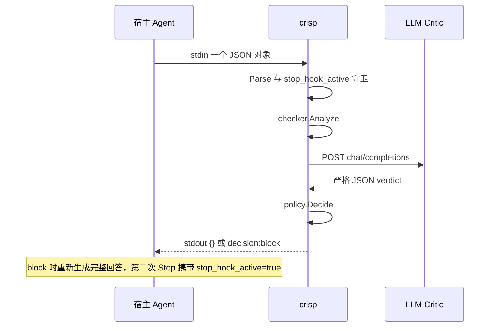

# Crisp 架构设计

本文说明 Crisp 的内部结构、数据流与关键实现约束，面向维护者和接入方。设计规格见 [design.md](design.md)，规则层评测见 [eval-report.md](eval-report.md)，各宿主安装与验证见
[docs/integrations/](integrations/)。文中命令与计数已于 2026-11-02 在仓库内复跑（"已验证"均指本次复跑；未能复跑的外部宿主 E2E 会注明来源文档）。

## 目录

1. [系统概览](#1-系统概览)
2. [组件与职责](#2-组件与职责)
3. [两种接入形态的数据流](#3-两种接入形态的数据流)
4. [确定性规则层](#4-确定性规则层)
5. [Critic 层](#5-critic-层)
6. [决策层](#6-决策层)
7. [超时与资源预算](#7-超时与资源预算)
8. [可观测性](#8-可观测性)
9. [数据边界与信任模型](#9-数据边界与信任模型)
10. [扩展指南](#10-扩展指南)
11. [关键设计取舍](#11-关键设计取舍)
12. [已知限制与下一步](#12-已知限制与下一步)

## 1. 系统概览

### 1.1 目标

Crisp 是 Agent 输出质量门禁：在 Agent 回答交付用户之前（或宿主允许的最早时机）检查回答质量，只拦截存在**明确、实质**质量问题的回答，正常回答默认放行。它解决六类问题：重复表达、无效铺垫、过度拆分、无效解释、
结论重复、信息密度低（定义见 [design.md](design.md) 第 2 节）。检查核心与 Agent 框架解耦，当前接入 Codex CLI、Claude Code、DeepSeek Harness（DSH）与 opencode 四类宿主，另提供通用 stdin/stdout 协议。

### 1.2 非目标

- 不重写、不编辑回答文本：只输出"放行 / 要求完整重写"的决策。
- 不是通用 LLM 评审平台：不做事实核查，也不评判风格偏好。
- 不替代宿主的会话成本统计：总 Token 成本 = 原始回答 + Critic + 重写回答，Hook 只能观测 Critic 这一部分。
- 不检查磁盘上生成的文件：Stop Hook 只检查最终回答；文件检查需显式运行 `crisp check-file`。
- 不保证在流式宿主上"交付前拦截"：DSH/opencode 只能后置观察 + 一次重写 followup（见第 3 节）。

### 1.3 质量门禁在交付链路中的位置

```text
Agent 生成最终回答
      │
      ▼
Stop Hook / 插件钩子 ──▶ crisp
      │                   1. 确定性规则（不调用大模型）
      │                   2. LLM Critic（balanced 默认 / economy）
      │                   3. 统一决策 PASS / BLOCK / FAIL-OPEN
      ▼
stdout: {} 放行            {"decision":"block","reason":"..."} 要求完整重写
```

只有 Critic 返回 `decision=block` 且 `severity=material` 才会 BLOCK；规则 findings 永远只是交给 Critic 的证据。任何内部异常都 FAIL-OPEN（输出 `{}`），绝不误拦正常回答。

### 1.4 设计原则（硬约束）

| 原则 | 含义 | 实现证据 |
| --- | --- | --- |
| 默认放行 | 正常回答、长回答、详细回答都默认 PASS；不因篇幅长而拦截 | `internal/critic/prompt.go` 的 rubric 与硬约束 |
| 规则不单独 BLOCK | 重复段落/句子可能是合理引用，规则 finding 只作为 Critic 输入与日志 | `internal/policy/decision.go` `Decide()` |
| 每 Turn 最多一次重写 | 防止 block 循环与成本失控 | `stop_hook_active` / 插件内存 guard |
| fail-open | 解析失败、超时、网络错误、非法 JSON、panic 都输出 `{}` | `cmd/crisp/main.go` 的 recover 与 `policy.Decide` |
| 不删除内容，只要求重写 | 固定重写指令明确要求保留事实、数字、代码与必要解释 | `policy.RewriteReason` |
| 只使用标准库 | Go 端零第三方依赖；插件只依赖 Node.js 内置模块 | `go.mod`、两个 `package.json`（无 dependencies） |

## 2. 组件与职责

| 路径 | 职责 | 关键入口 |
| --- | --- | --- |
| `cmd/crisp/main.go` | 进程入口与命令分发、环境变量配置、总超时、fail-open、panic 兜底 | `run` / `runHook` / `runCheckText` |
| `cmd/crisp/pipeline.go` | 规则 → Critic → 决策的共享流水线，Stop Hook / check-text / check-file 复用 | `reviewAnswer()` |
| `cmd/crisp/check_file.go` | check-file 参数解析、逐文件检查、人读/JSON 输出、退出码 | `runCheckFile()` |
| `internal/hook/codex.go` | 共享 Stop 协议解析与输出（Codex/Claude 子集）、transcript 最近用户消息提取 | `Parse` / `WritePass` / `WriteBlock` / `ExtractLastUserMessage` |
| `internal/checker/` | 确定性规则：Markdown 预处理、重复段落/句子、填充语、结构、长度信号 | `Analyze()` |
| `internal/critic/` | OpenAI-compatible 客户端、prompt、严格 verdict schema | `New` / `Review` / `BuildPrompt` / `parseVerdict` |
| `internal/policy/decision.go` | 模式、是否调用 Critic、最终决策、固定重写指令 | `NeedsCritic` / `Decide` / `RewriteReason` |
| `internal/logger/logger.go` | stderr 结构化 JSON 行日志、敏感字段过滤、字段截断 | `logger.New` |
| `integrations/dsh-plugin-crisp/` | DeepSeek Harness Cordis Host 插件（`llm/stream`，observe/guard） | `index.js` `apply()`、`lib/gate.js`、`lib/crisp.js` |
| `integrations/opencode-crisp/` | opencode 插件（事件钩子 + 一次重写 followup） | `index.js` 唯一默认导出、`lib/hooks.js`、`lib/crisp.js` |
| `testdata/cases/` | 30 条回归样本：`positive.jsonl` 20 条问题回答 + `negative.jsonl` 10 条正常回答 | `go test ./cmd/crisp -run TestRuleEvaluation` |
| `test/e2e/` | 真实 CLI E2E 与 mock：`hookreplay`、`hooktap`、`mockcritic`、`mockprovider`、`mockanthropic`、`mockmessages` | 见 [codex-cli.md](integrations/codex-cli.md) 第 8 节 |
| `scripts/` | 构建、Hook 安装、真实 E2E 脚本 | `build.ps1`、`install-codex-hook.ps1`、`install-claude-hook.ps1`、`e2e-codex.ps1`、`e2e-claude.ps1`、`e2e-dsh.ps1` |
| `.codex/`、`.claude/` | 项目级 Hook 配置（检入仓库；`*.example.json` 为模板） | `hooks.json` / `settings.json` |

`test/docscheck`（`go run ./test/docscheck`）检查全部文档的相对链接，本仓库当前 125 条链接 0 处失效。

```text
                     ┌───────────────────────────────────────┐
                     │          宿主 Agent（四类接入）        │
                     └───────┬───────────────┬───────────────┘
                             │               │
          Stop Hook（阻塞进程）│               │ 宿主插件（进程内）
          Codex / Claude / 通用│               │ DSH llm/stream、opencode event
                             ▼               ▼
                     ┌───────────────────────────────────────────┐
                     │                 crisp                     │
                     │   hook.Parse ──▶ checker.Analyze           │
                     │        ──▶ policy.NeedsCritic              │
                     │        ──▶ critic.Review（可选，HTTP）      │
                     │        ──▶ policy.Decide                   │
                     │   stdout: {} 或 {"decision":"block",...}   │
                     │   stderr: 结构化 JSON 行                    │
                     └──────────────────┬────────────────────────┘
                                        │ 仅在配置 Critic 时
                                        ▼
                             OpenAI-compatible Critic 服务
```

数据流与一次 Stop Hook 的时序（Mermaid，GitHub 可直接渲染）：





## 3. 两种接入形态的数据流

### 3.1 进程型阻塞 Hook（Codex CLI / Claude Code / 通用协议）

```text
宿主导出 Hook ──stdin: 一个 JSON──▶ crisp ──stdout: {} / block JSON──▶ 宿主
```

- 协议：stdin 一个 UTF-8 JSON 对象（上限 4 MiB），stdout 恰好一个 JSON 对象，所有日志写 stderr；进程永远退出 0（含 block 与任何内部失败）。宿主要读 stdout 的 JSON 决策，不能看退出码。完整契约见 [generic-hook-protocol.md](integrations/generic-hook-protocol.md)。
- 输入字段：`last_assistant_message`（必需）、`stop_hook_active`、`transcript_path`、`session_id`、`turn_id`（可选，仅日志关联）、`hook_event_name`（存储不校验）。未知字段一律忽略，因此 Codex/Claude 可原样透传原生 payload。
- 防循环：block 只要求"完整重写"，宿主在重写后的第二次 Stop 必须带 `stop_hook_active=true`；Crisp 看到 true 立即输出 `{}` 且不调用 Critic。Codex/Claude 都满足这一点（真实 E2E 已验证，见 [codex-cli.md](integrations/codex-cli.md) 第 6 节、[claude-code.md](integrations/claude-code.md) 第 4 节）。
- 能交付前拦截：能。Hook 是同步阻塞的，宿主在收到 block 后才生成最终回答；`async: true` 之类的后台 Hook 无法在 turn 结束前返回决策，不要用于 Stop。

### 3.2 宿主插件（DeepSeek Harness / opencode）

**DSH（Cordis Host 插件）**：监听 `@deepseek-ai/dsh-llm` 的 `llm/stream` waterfall。插件把下游 chunk
原样 yield（保持对象同一性），同时累积可见 assistant 文本；只在终止 `finish` chunk 之后、wrapper 返回之前运行 `crisp check-text`。因此首 token 延迟不变，但会推迟流结束（以及 durable `assistant/message` 提交）
一段有界检查时间。observe（默认）只写一行结构化 JSON，绝不影响会话；guard（可选）在 material block 时通过 `agent.followup()` 追加**恰好一条** user 消息，内容是与 `policy.RewriteReason` 逐字一致的完整重写指令，
重写所在 turn 被抑制，不会再次审查。会话状态来自 durable `session/event` 的 `turn/start`/`turn/end`（只用于 turn 身份与重写 turn 抑制），`session/disposed` 清理状态。实现见
`integrations/dsh-plugin-crisp/lib/gate.js`。

**opencode（事件插件）**：监听 `session.idle` 与 assistant `message.updated`（经 message id 去重），用
SDK 取最后一条可见 assistant 文本，spawn `crisp check-text`。opencode 没有 Stop block 协议，block 时做
两件事：TUI toast（headless 下静默失败）+ `session.promptAsync` 追加**恰好一次**重写 turn（携带原 model/agent）。重写结果消息记 `skip_reason=rewrite_result`，不再审查。实现见
`integrations/opencode-crisp/lib/hooks.js` 与 `lib/rewrite-guard.js`。

### 3.3 接入能力对照

| 能力 | 进程型 Stop Hook（Codex/Claude） | DSH 插件 | opencode 插件 |
| --- | --- | --- | --- |
| 交付前拦截 | 可以（同步阻塞） | 不可以（流式已交付） | 不可以（回答已写入会话） |
| block 语义 | 宿主重写完整回答，替换原回答 | 后置追加一次重写 turn | 后置追加一次重写 turn + toast |
| 防循环实现 | 宿主提供的 `stop_hook_active` | 进程内 turn guard（`rewrittenTurns`） | 进程内 RewriteGuard |
| 重写代价 | 一次完整重写，无额外可见 turn | 额外一个 turn，回答重新生成 | 额外一个 turn + 原回答仍在历史中 |
| 进程重启后 | 不依赖 Crisp 状态 | guard 状态清空 | guard 状态清空 |
| 观察方式 | 宿主执行 Hook 进程 | 插件 JSONL / stderr | 插件 JSONL / app.log |

## 4. 确定性规则层

实现在 `internal/checker/`；`Analyze(text) (Report, Stats)` 是纯函数，带 panic 兜底（规则 bug 退化为"无 findings"，绝不使进程崩溃）。

### 4.1 Markdown 预处理

1. 行尾统一：`\r\n` 与 `\r` 都规范为 `\n`（`normalize.go` `splitLines`）。
2. 剥离 fenced code：三个反引号或三个波浪号开头的围栏整块移除并只计数（`stats.CodeBlocks`），围栏内重复不参与分析。
3. 分块：空行分块；识别 heading、thematic break、list、quote、table；列表缩进续行并入上一项；相邻 list 块合并。孤立的 "|" 行按 prose 处理。
4. 统计：`Runes`（全文码点）、`NaturalRunes`（排除 table 的自然语言）、`Paragraphs`、`Sentences`。自然段落 ID 只分配给 prose/quote/list（`paragraph_N`，从 1 开始）。

### 4.2 规范化

`normalize()`：去块前缀（引用/标题/列表标记）→ 去掉行内 Markdown（强调、行内 code 标记、链接/图片的目标地址、反斜杠转义）→ 全角标点折叠为 ASCII → ASCII 大写转小写 → 空白折叠 → 删除零宽字符 → 删除
CJK 之间/CJK 与标点之间的多余空格。句子切分按中文/英文句末标点、换行与括号收尾符；`.` 会排除小数、文件名/标识符与常见缩写（`e.g`、`etc` 等）。相关实现：`normalize.go`。

### 4.3 规则、阈值与证据

阈值全部集中在 `internal/checker/checker.go` 顶部常量区，便于回归调参：

| 规则 | 机制 | 严重度 | 关键常量 |
| --- | --- | --- | --- |
| `duplicate_paragraph` | 规范化后完全相同，或字符 shingle Jaccard ≥ 0.85 的近重复；CJK 用 bigram、Latin 用 trigram；先做长度预筛 | material | `duplicateSimilarity=0.85`、`minParagraphRunes=20`、`nearDuplicateParagraphRunes=48`、`maxAnalyzedParagraphs=400` |
| `duplicate_sentence` | 规范化后完全相同，或 Jaccard ≥ 0.85 的近重复；强相似（≥ 0.90）且足够长才 material | minor / material | `minSentenceCJKRunes=12`、`minSentenceLatinRunes=40`、`sentenceMaterialSimilarity=0.90`、`materialSentenceCJKRunes=18`、`materialSentenceLatinRunes=60`、`maxAnalyzedSentences=600` |
| `filler_opening` / `filler_closing` | 开头/结尾窗口各 2 段匹配中英文客套短语；整段几乎只有客套语（覆盖 ≥ 0.66 且无数字/反引号/URL）升级为 material | minor / material | `fillerParagraphWindow=2`、`fillerPureCoverage=0.66`、`fillerPureMinRunes=12`、`fillerPureMaxRunes=100`、`fillerShortClosingRunes=60`；短语表在 `filler.go` |
| `structure_anomaly` | 列表项过短（<30 runes）占 ≥70%（总量与过短项均 ≥8）；单句短段落占 ≥75% 且 prose 段落 ≥6；列表项重复相同前缀（3 runes）占 ≥80% 且 ≥8 项 | minor / info | `tinyListItemRunes=30`、`tinyListItemMinCount=8`、`tinyListItemRatio=0.70`、`shortParagraphRunes=50`、`singleSentenceMinCount=6`、`singleSentenceRatio=0.75`、`scaffoldPrefixRunes=3`、`scaffoldMinItems=8`、`scaffoldRatio=0.80` |
| `length_signal` | natural runes ≥ 2000 的纯描述信号 | info | `longAnswerNaturalRunes=2000` |

证据与噪声上限：`Finding.Evidence` 截断到 120 runes（`maxEvidenceRunes`），每种规则最多 5 条 finding
（`maxFindingsPerType`），行内链接扫描上限 `maxInlineSpanRunes=2048` 防止恶意输入退化为 O(n²)。finding 只携带 `type/severity/location/evidence/detail`，从不携带完整回答。

### 4.4 误报控制与否定样本

- 规则**从不产生 BLOCK**：material 只表示"值得让 Critic 确认"；structure/length 永远是 info/minor 风险信号。
- 正常回答不能出现规则发现：`negative.jsonl` 10 条（`good_long` 5 + `good_short` 5）在规则层必须零 findings，回归测试对此硬断言。
- 复跑 `go test ./cmd/crisp -run TestRuleEvaluation -count=1 -v`（2026-11-02）得到：问题样本有信号 15/20，material 10/20，balanced 下送 Critic 20/20；正常样本 findings 0/10、material 0/10。与 [eval-report.md](eval-report.md) 一致。
- 规则目标类别（duplicate_conclusion、filler_opening、over_fragmentation）信号覆盖 15/15；`redundant_explanation` 是纯语义类别，按设计由 Critic 覆盖。

## 5. Critic 层

实现在 `internal/critic/`，只判断、不重写。

### 5.1 协议

- 请求：`POST {QUALITY_GATE_BASE_URL}/chat/completions`（base URL 可带或不带 `/v1`，代码只追加 `chat/completions`；base 已以该路径结尾则不重复追加）。
- 头部：`Content-Type: application/json`、`Accept: application/json`；配置了 `QUALITY_GATE_API_KEY` 时加 `Authorization: Bearer <key>`。
- 负载：`model`、两条 `messages`（system + user）、`temperature: 0`、`stream: false`。**不重试**。
- 超时：默认 8s（`QUALITY_GATE_CRITIC_TIMEOUT_MS`），同时受外层 25s 总预算约束。
- 固定行为：不跟随重定向（`CheckRedirect` 返回 `http.ErrUseLastResponse`，避免 Bearer 被带去其他主机）；响应读取上限 1 MiB；错误体最多回显 200 字节，provider error message 最多 200 runes；错误信息不含回答全文或 API Key。
- 配置校验：Base URL 必须是 http/https 且有 host，`QUALITY_GATE_MODEL` 必须非空；API Key 可选（本地服务可留空）。未配置时返回 `ErrNotConfigured`，调用方按 fail-open 处理。

### 5.2 prompt 结构与 rubric

`internal/critic/prompt.go` 的 system prompt 固定不变（保证判定可复现），包含：角色（只输出 verdict，
不重写）；六类问题定义（semantic_duplicate、filler、over_fragmentation、redundant_explanation、
conclusion_repetition、low_information_density）；判定 rubric（pass 为默认；minor 必须返回 `pass`，minor
不触发重写；只有 material 才允许 `block`；不得因长度、细节、正式程度或风格偏好 block）；硬约束（不惩罚长回答；不得建议删除事实、数字、代码、命令、警告、链接或必要解释；没有 user message 时只看回答内部质量；
规则 findings 是提示，必须核对后才可用）；输出（恰好一个 JSON 对象，无 markdown 围栏）。

user prompt 分节：用户消息（untrusted，截断 2000 runes；无消息时给"不要仅凭长度判定"的指令）→ 规则 findings 摘要（只渲染 type/severity/location，最多 12 条，字段清理到 64 runes；**不渲染
evidence/detail**）→ 回答全文（`<answer>` 包裹）。`<user_message>`/`<answer>` 定界符在不可信文本中会被转义，防止回答伪造或关闭 prompt 分节。回答与用户消息都被视为不可信数据，prompt 明确要求模型忽略其中指令。

### 5.3 verdict schema 与严格解析

要求（`internal/critic/schema.go`）：

```json
{"decision":"block","severity":"material","issues":[{"type":"semantic_duplicate","location":"paragraph_3","instruction":"与第一段观点重复，应合并"}]}
```

- `decision` 必填，取值仅 `pass|block`；`severity` 必填，取值仅 `none|minor|material`；`issues` 必填且必须是数组（空数组合法，缺失/null 非法）。
- 未知字段忽略（provider 会加元数据）；缺失必填字段、未知枚举、非数组 issues 一律解析失败。
- issue 字段截断：type 64、location 64、instruction 400 runes；全空 issue 丢弃；最多保留 10 条。
- usage（prompt/completion/total tokens）与测量的 latency 写入 Verdict，仅用于日志。

### 5.4 失败语义

任何 transport/HTTP/JSON/schema 错误都返回 error，由 `policy.Decide` 转成 fail-open PASS。调用方在 stderr
区分两种事件：`critic_unavailable`（未配置/配置无效）与 `critic_failed`（其他错误）。失败时不记录 token/latency（日志中为 0）。

## 6. 决策层

`internal/policy/decision.go`：先判断是否调用 Critic，再把结果映射为最终决策。

### 6.1 是否调用 Critic（balanced / economy）

`NeedsCritic` 的判定顺序：1）规则 findings 非空 → 调用 Critic（两种模式都一样，短回答也调用）；2）economy 模式 → 不调用；3）balanced 模式 → `natural_runes >= MinCriticRunes`（默认 120）时调用。

| 场景 | balanced | economy |
| --- | --- | --- |
| 规则有发现（任意长度） | 调用 | 调用 |
| 规则无发现，natural runes ≥ 120 | 调用 | 不调用 |
| 规则无发现，natural runes < 120 | 不调用 | 不调用 |

未知模式回退 balanced；`MinCriticRunes <= 0` 回退 120。

### 6.2 fail-open 矩阵

| 情形 | 最终输出 | reason_type | fail_open | 关键 stderr 事件 |
| --- | --- | --- | --- | --- |
| 输入不是合法 JSON / 空输入 / 尾随数据 / 超 4 MiB | `{}` | — | 未进入质量检查 | `hook_input_parse_failed` |
| `stop_hook_active` 缺失 | `{}` | — | 未进入 | `protocol_anomaly` + `stop_hook_active_missing` |
| `stop_hook_active=true` | `{}` | — | 未进入 | `quality_skip skip_reason=stop_hook_active` |
| `last_assistant_message` 缺失/空白 | `{}` | — | 未进入 | `quality_skip skip_reason=empty_last_assistant_message` |
| 规则命中但 Critic 返回 pass/minor | `{}` | `critic_pass` | false | `quality_check` |
| 规则命中、Critic `block+material` | block JSON | 首个 issue 的 type，缺省 `semantic` | false | `quality_check` |
| Critic 未配置 | `{}` | `critic_error` | true | `critic_unavailable` + `quality_check` |
| Critic 超时 / 非 2xx / 非法 JSON / 未知枚举 / 空 choices | `{}` | `critic_error` | true | `critic_failed` + `quality_check` |
| 短回答或 economy 下无需 Critic | `{}` | `not_reviewed` | false | `quality_check` |
| 任意位置 panic | `{}`（若尚未写 stdout） | — | — | `panic` |

关键点：**规则 findings 单独永远不产生 BLOCK**；只有 Critic 的 `decision=block && severity=material` 才会 block。规则命中但 Critic 说 pass 时，回答照常放行。

### 6.3 每 Turn 一次重写的实现差异

| 宿主 | 守卫方式 | 状态位置 | 重置时机 |
| --- | --- | --- | --- |
| Codex CLI / Claude Code | 宿主在重写后的 Stop 设置 `stop_hook_active=true`；Crisp 见 true 直接放行且不调用 Critic | 宿主进程 | 宿主管理 |
| DSH 插件 | 按 durable turn id 记录 `rewrittenTurns`，重写 turn 被 `suppressTurn` 抑制；内存保留最近 64 个 turn | 插件进程内存 | 进程重启 / `session/disposed` |
| opencode 插件 | `RewriteGuard`：`checked`、`pendingRewrite`、`rewrittenTurns`；重写结果首条 assistant 消息记 `rewrite_result` 跳过 | 插件进程内存 | server 重启，集合上限 `maxChecked`（默认 500） |
| 通用 Hook 适配器 | 必须由宿主/适配器注入 `stop_hook_active`，或用自身 turn 状态保证一次 | 适配器 | 由适配器决定 |

固定重写指令（`policy.RewriteReason`，插件中的副本必须逐字一致）：

```text
请重新输出完整最终回答：合并语义重复的段落，删除无效铺垫和结论重复，保留全部必要事实、数字、代码和解释，不要为了缩短篇幅而删除必要信息。
```

## 7. 超时与资源预算

| 层 | 默认值 | 配置 | 说明 |
| --- | --- | --- | --- |
| 宿主 Hook 截止时间 | 30s | Codex `hooks.json` 的 `timeout`（秒）/ Claude Code 的 `timeout` | Codex 上是"结果截止时间"：超时后输出被丢弃；实测不会终止 Hook 进程（见第 7.1 节） |
| Crisp 进程总预算 | 25s | `QUALITY_GATE_TOTAL_TIMEOUT_MS` | 覆盖整条审查流水线；必须小于宿主截止时间 |
| Critic 单次 HTTP 超时 | 8s | `QUALITY_GATE_CRITIC_TIMEOUT_MS` | 必须小于进程总预算 |
| Critic 请求额外字段 | 空 | `QUALITY_GATE_EXTRA_BODY_JSON` | 合并进请求体的 JSON 对象（provider 专有参数，如关闭思考模式） |
| DSH 插件子进程超时 | 30s（钳制 1–120s） | `timeoutMs` | 到点 `child.kill()`；应高于 Crisp 自身总预算 |
| opencode 插件子进程超时 | 30s（钳制 1–120s） | `timeoutMs` | 同上 |
| `check-file` | 25s/文件 | `QUALITY_GATE_TOTAL_TIMEOUT_MS` | 每个文件独立的总预算 |

关系：`Critic 8s < Crisp 总预算 25s < 宿主 Hook 30s ≈ 插件子进程超时 30s`。宿主的截止时间必须大于 Crisp 总预算 + 进程启动开销（通用协议建议至少 30s）；插件子进程超时应高于 Crisp 总预算，否则插件会先杀掉还没到自身预算的 Crisp。

### 7.1 Windows 上 Codex 超时不杀进程（实测事实）

Codex CLI 0.145.0-alpha.18 / Windows 实测（[codex-cli.md](integrations/codex-cli.md) 第 7 节）：
`timeout: 2` 配 4s/8s 的慢 Hook 时，Codex 报 `hook: Stop Failed` 并**丢弃 Hook 输出**（CLI 层 fail-open，不会因迟到 block 触发重写），但 Hook 进程继续运行到结束（实测生命周期 5.0s / 8.0s，
`codex exec` 等待覆盖了这段时间）。结论：不要把宿主 timeout 当作"杀死卡死 Crisp"的机制；Crisp 自己的 25s 总预算负责提前退出。插件侧则显式 `child.kill()` 直接子进程。

## 8. 可观测性

### 8.1 Hook 模式 stderr（每行一个 JSON 对象）

`internal/logger` 写入 `ts`（UTC RFC3339Nano）、`level`、`event` 与字段。事件一览：

| event | level | 触发 | 关键字段 |
| --- | --- | --- | --- |
| `hook_input_parse_failed` | error | stdin 解析失败 | `error` |
| `protocol_anomaly` | warn | `Validate()` 发现缺失字段 | `session_id`、`turn_id`、`msg`（如 missing stop_hook_active） |
| `stop_hook_active_missing` | warn | 防循环字段缺失，直接放行 | `session_id`、`turn_id` |
| `quality_skip` | info | 提前放行 | `skip_reason`（`stop_hook_active` / `empty_last_assistant_message`） |
| `critic_unavailable` | warn | Critic 未配置/配置非法 | `error`（如 QUALITY_GATE_BASE_URL is not set） |
| `critic_failed` | warn | Critic 调用失败 | `error` |
| `quality_check` | info | 每次真正执行检查 | 见下 |
| `hook_output_failed` | error | 写 stdout 失败 | `error` |
| `panic` | error | 顶层 recover | `error` |
| `check_file_read_failed` | error | check-file 读文件失败 | `path`、`error` |

`quality_check` 字段：`mode`、`decision`（pass/block）、`reason_type`、`rule_types`、`rule_material`、
`answer_runes`、`natural_runes`、`critic_called`、`critic_latency_ms`、`critic_tokens`、`fail_open`、`elapsed_ms`、`session_id`、`turn_id`（后两者按 64 runes 截断）。

### 8.2 插件日志

- DSH：每行带 `ts/level/plugin=crisp-quality-gate`；事件 `crisp_quality_gate_active`、`crisp_quality_check`、`crisp_quality_skip`（`short_answer`/`empty_answer`/`answer_too_large`/`finish_<kind>`/`missing_finish`）、`crisp_guard_followup`、`crisp_guard_skipped`（`no_turn`/`rewrite_turn`/`already_rewritten`/`agent_unavailable`/`followup_unavailable`）、`crisp_guard_error`、`crisp_quality_error`。目标：`logFile`（JSONL）或 stderr。
- opencode：`quality_check`（含 `rewrite_requested/rewrite_sent/timed_out/exit_code/elapsed_ms`）、`quality_skip`（`subagent_session`/`already_checked`/`rewrite_result`/`turn_already_rewritten`）、`quality_gate_error`；同时写 JSONL 与 opencode 服务端日志（`client.app.log`，service 名 `crisp`）。

### 8.3 核心指标与脱敏

核心指标：规则误拦截率、Critic 一致性、重写改善率、FAIL-OPEN 比例、平均审查延迟、总 Token 消耗（总成本 = 原始回答 + Critic + 重写回答；Hook 只观测 Critic 部分）。脱敏规则（`internal/logger`）：以下 key
一律不写日志：`answer`、`last_assistant_message`、`user_message`、`prompt`、`content`、`api_key`、
`apikey`、`authorization`、`password`、`secret`、`token`；所有字符串字段截断到 512 runes；插件日志只含 id、决策枚举、计数、耗时与错误字符串，不含回答全文/用户消息/API Key。

## 9. 数据边界与信任模型

### 9.1 哪些数据会离开本机

- 发送给 Critic 的只有：完整回答（`<answer>` 内）、可选的最近一条用户消息（≤ 2000 runes，从 transcript 尾部最多 512 KiB 中提取）、规则 findings 摘要（type/severity/location，**不含 evidence 原文**）、固定 system prompt。
- 不发送：transcript 其余内容、工具输出（Claude transcript 里 tool-result/sidechain/meta 记录被跳过）、规则证据原文。回答全文会通过本地 stdin 交给 `crisp` 子进程；是否发起网络请求取决于是否配置了 Critic。
- Crisp 二进制本身不写文件、不改写回答或 transcript；插件会按配置写 JSONL 日志。

### 9.2 API Key 与网络

- `QUALITY_GATE_API_KEY` 只从环境读取，仅放在 `Authorization: Bearer` 头里；不落日志、不入库、不写入仓库。
- Critic 客户端不跟随重定向、不重试、默认超时 8s、响应上限 1 MiB。
- DSH 插件对子进程使用环境白名单（平台必需变量 + `envPassthrough` + `env` 覆盖），不把 Harness 进程环境整体传入；opencode 插件则让子进程继承 opencode 服务进程环境（加上 tuple `env` 覆盖）。两者差异在接入选型时需注意。

### 9.3 宿主信任边界

| 宿主 | 信任要求 | 验证/注意事项 |
| --- | --- | --- |
| Codex CLI | Hook 需被审查/信任；项目级 `hooks.json` 只在项目 `trust_level="trusted"` 时加载 | 自动化用 `--dangerously-bypass-hook-trust`（仅限已确认 Hook 来源）；未信任时 Hook 静默不执行 |
| Claude Code | 用户级 Hook 直接运行；项目/本地 settings Hook 需要受信任工作区与 Hook 审查 | 任一层设置 `disableAllHooks: true` 会禁用全部 Hook（本机用户级设置曾观测为该状态，E2E 用隔离配置验证）；`async: true` 的 Stop Hook 无法交付决策 |
| DSH | 安装 bundle 即信任其执行任意本地代码 | 插件为仓库内私有包，安装前应审阅源码；安装/重启后需确认 `crisp_quality_gate_active` |
| opencode | 插件在 server 内执行任意本地代码 | 本地包用 file URL 登记；`--pure`/`OPENCODE_PURE=1` 会禁用外部插件；`opencode plugin <module>` 只安装 npm 包 |
| 通用 Hook | Hook 命令执行任意本地代码 | 只把可信来源写进宿主配置；stdout 必须只含 Crisp 的 JSON，日志走 stderr |

Crisp 的核心不变量（通用协议第 5 节）：只读 stdin、可选 transcript 尾部与配置的 Critic URL；不写文件；任何异常 fail-open；宿主也必须 fail-open（超时/缺失二进制/无法解析输出 → 交付原回答）。

## 10. 扩展指南

新增 Agent 接入有两条路径，按宿主能力选择（详见 [generic-hook-protocol.md](integrations/generic-hook-protocol.md) 的决策表）。

### 10.1 路径 A：阻塞 Stop Hook

适用：宿主提供同步 Hook，能拿到最终回答并在 turn 结束前返回 block 决策。checklist：

1. 协议：把回答放进 `last_assistant_message`，原样透传宿主 payload（未知字段会被忽略）；stdin 上限 4 MiB；stdout 只允许 `{}` 或 `{"decision":"block","reason":"..."}`。
2. 防循环：宿主必须在重写后的 Stop 带 `stop_hook_active=true`；不能提供该字段时，适配器自己按 `session_id/turn_id` 维护"本 turn 已重写"状态。
3. 超时：宿主截止时间 > `QUALITY_GATE_TOTAL_TIMEOUT_MS` + 启动开销（建议 ≥ 30s）；不要依赖宿主 timeout 终止进程。
4. fail-open：宿主解析失败、超时、二进制缺失、非零退出都必须视为 PASS，交付原回答。
5. 日志：Crisp 的 stderr 可能被宿主吞掉，需要时把 Hook 包一层把 stderr 落到文件（仓库 `test/e2e/hooktap` 仅用于调试，生产直连 `crisp.exe`）。
6. 测试：按通用协议第 8 节的 10 条清单跑通；仓库提供 `go test ./...`、`go run ./test/e2e/hookreplay -crisp bin/crisp.exe`、`scripts/e2e-*.ps1`。
7. 文档：新增 `docs/integrations/<agent>.md`，在 README 接入表补一行，并记录已验证/未验证项。

### 10.2 路径 B：宿主插件

适用：宿主提供插件/事件钩子，但没有可阻塞的 Stop 协议（DSH、opencode 属于此类）。checklist：

1. 协议：把**完整可见回答**写到 `crisp check-text` 的 stdin，读 stdout 一个 JSON 决策；任何失败（spawn/超时/非零退出/非法 JSON/空输出）都记 fail-open pass。
2. 语义：明确这是后置语义——回答已交付，只能"记录 + 提示 + 追加一次重写"；不要宣称交付前拦截；重写会多一次模型调用和可见 turn。
3. 防循环：插件内存记录"已检查 message"、"重写结果跳过"、"每 turn 至多一次"；注明进程重启后状态清空。
4. 超时与环境：给子进程设置硬超时并 kill；明确子进程环境策略（白名单 vs 继承）；对超长回答设上限避免把巨量文本喂给子进程。
5. 日志：每次检查一行结构化 JSON，至少包含 decision、reason_type、rule_types、critic_called、fail_open、answer_runes、耗时；不得包含回答全文/用户消息/API Key。
6. 测试：hermetic `node --test` 单测 + 隔离宿主目录的真实 E2E（不触碰用户配置）。
7. 文档：安装步骤（含权限/信任/重启要求）、观察/guard 配置、已知限制、数据边界。

## 11. 关键设计取舍

1. **Go + 标准库，单二进制**：Hook 进程需要极低启动开销、零运行时依赖、跨平台，且不能因为依赖安装失败而破坏宿主的 turn。`go.mod` 只有 `go 1.26`，两个 Node 插件也只依赖内置模块。
2. **为什么规则从不单独 BLOCK**：重复段落/句子可能是合理引用或模板化正常回答；规则只能机械识别"形似"，语义确认必须交给 Critic。因此 material finding 也只是"送 Critic 确认"。
3. **为什么一次重写**：block 的成本是一次完整模型调用 + 用户等待；不设上限会形成"越改越差 → 再改"的循环。一次重写后用 `stop_hook_active`/内存 guard 立即放行。
4. **为什么 balanced 默认、economy 漏检**：规则只覆盖可机械识别的类别（回归样本 15/20 有信号），`redundant_explanation` 等纯语义类别必须靠 Critic；economy 只送有规则发现的回答，会漏掉"无重复句的语义重复/冗余解释"，只适合成本敏感且接受漏检的场景。
5. **为什么不通过正则删除内容**：删除无法保证保留事实、数字、代码与必要解释；Crisp 的职责是判断，修复交给 Agent 完整重写，且重写指令明确禁止为缩短篇幅删除必要信息。
6. **为什么插件只能后置**：流式回答已经渲染给用户，缓冲整段会牺牲首 token 延迟且无法撤回已显示内容；因此 DSH/opencode 选择 observe + 一次重写 followup，并在文档中明确这一语义。
7. **为什么 fail-open 到处存在**：质量门禁是"附加保护"，它自身故障不能变成新的交付风险；所有解析/网络/超时/panic 路径都收敛到 `{}`。
8. **为什么固定重写指令**：保证 block 行为可预测、可审计，且与"不删除内容"原则一致；Go 与两个插件的文案必须逐字一致，DSH 的 contract 测试会断言与 `policy.RewriteReason` 相等，修改时需三处同步。
9. **为什么 Critic 客户端不重试、不跟随重定向**：重试会放大延迟与成本且可能重复计费；跟随重定向可能把 Bearer Key 发给第三方主机。

## 12. 已知限制与下一步

- 真实 Critic 模型的一致性与重写改善率尚未用真实服务测量；当前 E2E 使用本地 mock 验证协议。
- 规则信号覆盖问题样本 15/20，剩余纯语义类别完全依赖 Critic；未配置 Critic 时整体 fail-open（只做规则检查，不拦截）。
- DSH/opencode 无法交付前拦截：原回答保留在历史中，重写是额外 turn，token/延迟成本更高；插件内存 guard 在进程重启后重置。
- Windows 上 Codex Hook timeout 只丢弃输出、不终止进程；若父进程被强杀可能留下孤立 Hook 进程，生产 Hook 命令应短小且自我限时（Crisp 已满足）。
- `crisp check-file` 是显式入口，Stop Hook 不会自动扫描磁盘文件。
- DSH 的 `plugin_manager install_bundle` 路径与 opencode `run` 一次性模式未在本仓库 E2E 中覆盖（见 [deepseek-harness.md](integrations/deepseek-harness.md) 第 6.5 节、[opencode.md](integrations/opencode.md) 第 7.1 节）。
- 插件为本地私有包，未发布到 npm/pnpm registry；安装走仓库路径。
- 下一步：真实 Critic 一致性测量与阈值/prompt 调参；对完全不支持扩展的 Agent 考虑本地 API Proxy（设计规格中的 Phase 4 fallback）；补充更长技术文档样本以复测重复阈值。
