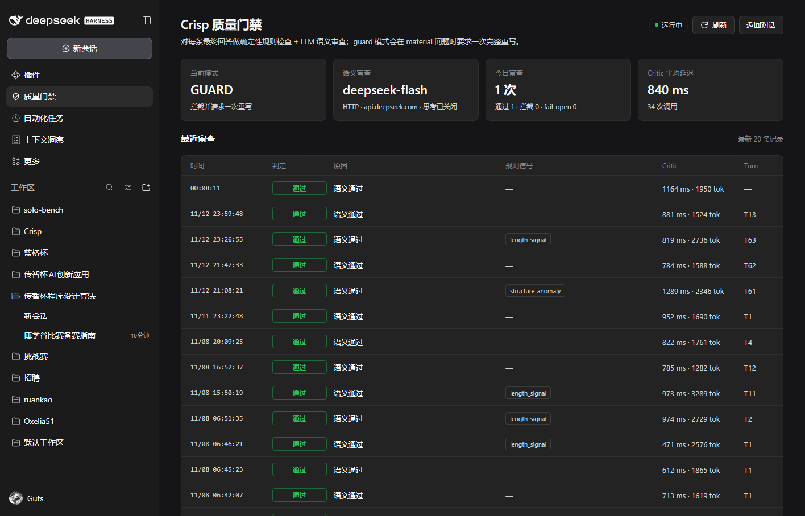

# Crisp × DeepSeek Harness (Cordis host plugin)

Status: **installable Host + Web bundle, verified on the installed DeepSeek
Harness 0.2.2-rc.1 (Windows, Node.js v22.19.0): real `desktop` profile, real
DeepSeek-V4.1-Flash HTTP Critic with thinking disabled, and the Web left-sidebar
status page in a headless browser.** The bundle lives at
[integrations/dsh-plugin-crisp/](../../integrations/dsh-plugin-crisp/) and is
registered by its own `cordis.patch.yml`; the Web half is declared by
`dsh.client` in the same `package.json`.

This page records exactly what was executed end to end, what was verified only
by unit tests, and what remains unverified. The guard flow is reproducible from
the repository: [scripts/e2e-dsh.ps1](../../scripts/e2e-dsh.ps1) runs the real
`dsh` launcher headless against committed local protocol mocks
([test/e2e/mockmessages](../../test/e2e/mockmessages/main.go) and
[test/e2e/mockcritic](../../test/e2e/mockcritic/main.go)). Real-provider and
live-Web measurements are recorded in sections 6.3 and 6.5.

---

## 1. What the gate does

Crisp (see [README.md](../../README.md)) checks a finished assistant answer with a
Go binary: deterministic rules first, an OpenAI-compatible LLM Critic second,
then a PASS / BLOCK / FAIL-OPEN decision. This integration mounts that binary as
a DeepSeek Harness Host plugin.

- **observe** (default): after every delivered assistant answer, run
  `crisp check-text` on the complete visible text, write one structured JSON
  decision line, and never influence the conversation.
- **guard** (opt-in): on a material BLOCK decision, queue exactly one
  user-role followup asking for the fixed full rewrite from
  [internal/policy/decision.go](../../internal/policy/decision.go). The rewrite is
  a new turn; a rewrite turn is never gated again, so a bad rewrite cannot
  loop.
- The semantic Critic can be an **external OpenAI-compatible HTTP endpoint**
  (default) or the **Harness's own signed-in model** through `ctx.llm`
  (`critic: harness`, e.g. DeepSeek-V4.1-Flash with thinking off). See
  [Critic modes](#critic-modes).
- The bundle also contributes a **Web UI left-sidebar entry** ("质量门禁" /
  "Quality gate") that opens a standalone status page: current mode, critic
  model/capabilities, today's counters, average critic latency, and the latest
  20 checks read from the local JSONL log. The Host half serves that page's data
  as `GET /crisp/status`; no answer text or credentials are exposed. See
  [Left-sidebar status page](#left-sidebar-status-page).

Every failure (spawn error, timeout, non-zero exit, bad JSON) is a fail-open
pass, mirroring the Go core.

---

## 2. Architecture

```text
dsh agent loop
  └─ ctx.llm.stream(options)                     @deepseek-ai/dsh-llm
       └─ ctx.waterfall(this, "llm/stream", options, () => adapterStream())
            ├─ this bundle (listener; mounted last, so it wraps the adapter)
            │    async generator:
            │      for await (chunk of downstream) { accumulate; yield chunk }  <- object identity unchanged
            │      after terminal finish: spawn "crisp check-text" (bounded)
            │      log one JSON line; in guard mode queue agent.followup()
            └─ adapter stream (DeepSeek / pi-ai / retry wrappers)
```

Cordis waterfall semantics (verified from `@deepseek-ai/cordis` 4.0.5): a
listener receives the event payload and a `next` thunk and must return the
downstream value (`return next()`) unless it replaces it. For `llm/stream`
that value is the provider chunk stream, so the listener returns a wrapper
async generator. Chunks are yielded unchanged (same object references), so the
text streaming path is untouched.

Why this shape:

- **Token streaming is preserved.** First-token latency does not change; the
  gate never buffers before the first chunk.
- **The answer is only complete at the terminal `finish` chunk.** Crisp's
  `check-text` contract takes the whole answer on stdin and prints one decision
  object, so the check runs after the last chunk has been yielded to the loop
  but before the wrapper's generator returns `done`. This delays the durable
  `assistant/message` commit (and therefore tool-call start / turn end) by the
  bounded check latency; it does not delay streaming to the user. A hard
  pre-delivery block is impossible without buffering the entire answer and
  retracting it, which would sacrifice first-token latency (and cannot
  un-deliver chunks already rendered).
- **Turn identity comes from the durable session log.** The listener subscribes
  to `session/event` and folds only `turn/start` / `turn/end`, so logs carry
  the durable turn id and the guard has a per-turn dedupe key.
- **Guard uses `agent.followup()`.** The followup is queued at the terminal
  chunk, while the agent is still inside the step; the loop keeps running when
  its inbox has pending input, so the rewrite becomes the next turn. The
  obvious alternative — queueing from a `turn/end` observer — was implemented
  first and measured to lose a race with the one-shot headless runner
  (the followup was logged but the process exited after turn 1). `turn/end`
  is still read, but only to clear turn/suppression state.
- **Auxiliary model calls are ignored.** Agent-loop requests carry a
  `sessionId` but no `purpose`; session-title and compaction calls set
  `purpose` (`session-title`, `compaction`). The bundle pre-filters on that
  field, then (best effort) on `@deepseek-ai/dsh-llm`'s `isAgentLoopRequest`
  marker, which is loaded lazily so the bundle declares no dependency on the
  installation.

### Host plugin shape

`index.js` exports `apply(ctx, config)` (the Host-plugin export form) and a
`name` string; it deliberately exports **no `inject` list and no schemastery
`Config`**:

- No service is required at activation. The plugin only registers listeners;
  guard mode resolves `ctx.get("agents")` lazily when it actually needs
  `agent.followup()`, so the bundle stays active in profiles without an agent
  service and cannot fail startup for a missing dependency.
- The config is a plain defensive object (`lib/config.js`), which keeps the
  bundle independent of the Harness schemastery version. A bad value falls back
  to a safe default and is reported in the activation record's `warnings`.

The **Web half** (`client.js`) is a separate plain browser bundle declared with
`"dsh.client": { "platform": "web", "immediately": true }` and no Harness
client-package imports. It registers a `sidebar.panellist` entry and a keyed
`main` page, styles itself with `--dsw-alias-*` tokens only, and fetches
`/crisp/status` from the Host half. The Host half registers that exact route on
the optional `webServer` service when present; profiles without the Web UI keep
running the gate unchanged.

### Files

| File | Role |
|---|---|
| `integrations/dsh-plugin-crisp/package.json` | private ESM bundle manifest: `dsh.bundle.patch`, `dsh.client` (Web half), exports for index/client/locale/icon |
| `integrations/dsh-plugin-crisp/cordis.patch.yml` | inserts the single `crisp-quality-gate` row and its example config |
| `integrations/dsh-plugin-crisp/index.js` | Host plugin: `apply(ctx, config)` registers `llm/stream`, `session/event`, `session/disposed`, and the status route |
| `integrations/dsh-plugin-crisp/lib/gate.js` | chunk accumulator, check orchestration, guard followup, structured records |
| `integrations/dsh-plugin-crisp/lib/crisp.js` | bounded `crisp check-text` child process, decision parsing, fail-open |
| `integrations/dsh-plugin-crisp/lib/config.js` | defensive config, child-env allowlist, default binary resolution |
| `integrations/dsh-plugin-crisp/lib/log.js` | one JSON line per event to `logFile` or stderr |
| `integrations/dsh-plugin-crisp/lib/status.js` | read-only `GET /crisp/status` snapshot: sanitized config, counters, latest checks |
| `integrations/dsh-plugin-crisp/client.js` | Web half: left-sidebar entry + standalone status page (React from the module loader) |
| `integrations/dsh-plugin-crisp/locale/{en,zh}.json`, `icon.svg` | Plugin Manager display metadata and original icon |
| `integrations/dsh-plugin-crisp/test/` | 87 hermetic `node:test` tests (fake ctx, runner, child and status log fixtures) |

The end-to-end reproduction harness is committed too:
`scripts/e2e-dsh.ps1` (PowerShell 7) drives the real launcher and asserts the
guard flow, with a stdlib-only Messages-API SSE mock at
`test/e2e/mockmessages/main.go` and the shared OpenAI-compatible Critic mock at
`test/e2e/mockcritic/main.go`.

---

## 3. Prerequisites

1. **Crisp binary**

   ```powershell
   go build -o bin/crisp.exe ./cmd/crisp
   ```

   The plugin resolves a binary in this order: `binaryPath` config →
   `config.env.CRISP_BIN` → `CRISP_BIN` environment variable → the checkout's
   `bin/crisp.exe` (when the package still runs from the repo) → `crisp` on
   `PATH`.

2. **Critic configuration** (otherwise the gate only runs deterministic rules
   and fails open on any semantic doubt):

   ```powershell
   $env:QUALITY_GATE_BASE_URL = "https://api.example.com/v1"
   $env:QUALITY_GATE_API_KEY  = "sk-..."      # optional for local services
   $env:QUALITY_GATE_MODEL    = "critic-model"
   $env:QUALITY_GATE_MODE     = "balanced"
   ```

   These variables must exist in the **Harness process environment** or be set
   through the plugin's `env` config (see the env caveat in section 7). The
   spawned child sees only an allowlisted environment, not the whole Harness
   environment, so provider keys are not leaked to the quality gate.

3. **DSH 0.2.1-rc.5** (the version this bundle was verified against). Node.js
   >= 20 is required by the manifest.

---

## 4. Install

### 4.1 Recommended: Plugin Manager `install_bundle`

The shipped Cordis plugin-development docs specify this path: author the bundle
in the workspace, then call `plugin_manager` with
`action: "install_bundle"` and the **absolute package directory** as `target`
(it runs pnpm, saves the profile dependency, and enables the bundle). This path
was **not executed here**: the verification environment had no
`plugin_manager` tool and was not allowed to change the user's real profile.
It is documented from the package READMEs rather than from a run.

Target for this checkout:

```text
D:\05_Code\Crisp\integrations\dsh-plugin-crisp
```

Do not hand-edit the profile's `package.json`/`cordis.patch.yml` or run pnpm in
a real profile directory; `install_bundle` owns those steps.

### 4.2 CLI / package-manager path (executed in a scratch profile)

The launcher's own plugin management is `dsh plugin --profile <name> <pnpm args>`.
It initializes a profile, runs pnpm in it, saves the dependency, and appends a
new bundle dependency to `dsh.profile.bundles`. This was the path used for the
verification runs, against a throwaway `DSH_HOME` under `.tmp`:

```powershell
$env:DSH_HOME = 'D:\05_Code\Crisp\.tmp\dsh-home'   # scratch state only
$dsh = 'C:\Users\71408\AppData\Local\Programs\DeepSeek Harness\resources\runtime\cli\bin\dsh.cmd'

# 1. create a scratch profile from the shipped headless template
& $dsh --profile crisp-scratch --from-default-profile headless --dump-config

# 2. install this checkout as a linked package into that profile
& $dsh plugin --profile crisp-scratch add 'D:\05_Code\Crisp\integrations\dsh-plugin-crisp'

# 3. confirm the bundle layer and its row compose
& $dsh --profile crisp-scratch --dump-config | Select-String 'crisp-quality-gate' -Context 0,15
```

Observed after step 2/3 (scratch profile):

```json
"dependencies": { "@local/crisp-quality-gate": "link:D:/05_Code/Crisp/integrations/dsh-plugin-crisp" },
"dsh": { "profile": { "bundles": [
  "@deepseek-ai/dsh-base", "@deepseek-ai/dsh-headless", "@local/crisp-quality-gate"
] } }
```

```yaml
# == @local/crisp-quality-gate
- id: crisp-quality-gate
  name: '@local/crisp-quality-gate'
  config:
    mode: observe
    timeoutMs: 30000
    ...
```

Starting the profile mounts the row; a scratch boot (`--patch` overlay pinned a
log file) wrote the activation line:

```json
{"event":"crisp_quality_gate_active","mode":"observe","binary":"D:\\05_Code\\Crisp\\bin\\crisp.exe",
 "binary_exists":true,"timeout_ms":20000,"min_runes":1,...}
```

### 4.3 Installing into the real desktop profile (executed on this machine)

The desktop profile is managed by the Electron application:
`dsh --profile desktop --dump-config` is rejected with "profile desktop is managed exclusively by
the Electron application". Install from the workspace, validate the files statically, and reproduce
the composition in a scratch profile; the desktop app then mounts the row on its next start.

Procedure executed for this machine (paths are examples, substitute your own):

```powershell
# 0. back up the user profile layer (outside the repository)
$profile = "$env:USERPROFILE\.dsh\profiles\desktop"
$backup  = 'D:\05_Code\Crisp\.tmp\dsh-install-<stamp>'
New-Item -ItemType Directory -Force $backup | Out-Null
Copy-Item "$profile\package.json" "$profile\cordis.patch.yml" $backup

# 1. install the linked package; the launcher also appends the bundle to
#    dsh.profile.bundles (no manual package.json editing needed)
$dsh = 'C:\Users\71408\AppData\Local\Programs\DeepSeek Harness\resources\runtime\cli\bin\dsh.cmd'
& $dsh plugin --profile desktop add 'D:\05_Code\Crisp\integrations\dsh-plugin-crisp'

# 2. append/override the row config in $profile\cordis.patch.yml
#    (mode/binaryPath/logFile/envPassthrough; a matching id+name replaces the
#    bundle's default config completely)

# 3. validate without booting the desktop app: YAML parses, row exists, bundle listed
python -c "import json,yaml,pathlib; ..."

# 4. reproduce composition/activation in an isolated profile with the same patch
$env:DSH_HOME = 'D:\05_Code\Crisp\.tmp\dsh-verify-home'
& $dsh plugin --profile desktop-copy add 'D:\05_Code\Crisp\integrations\dsh-plugin-crisp'
Copy-Item "$profile\cordis.patch.yml" "$env:DSH_HOME\profiles\desktop-copy\cordis.patch.yml"
& $dsh --profile desktop-copy --dump-config   # exit 0, row patched by the real patch file
```

The scratch boot with the real patch wrote the expected activation record (`crisp_quality_gate_active`,
mode=observe, binary_exists=true, configured logFile), so the Loader accepts the row. The desktop app
must be restarted (or the plugin manager's HMR path used) before the long-lived process mounts it.

Notes:

- `dsh plugin add` runs pnpm in the profile. pnpm may move packages that are not in the declared
  dependency tree to `node_modules/.ignored` (housekeeping; files stay on disk). Declared bundles
  and dependencies are unaffected.
- Until a Critic is configured (`QUALITY_GATE_BASE_URL/API_KEY/MODEL` in the Harness process
  environment, or the commented `env:` block in the profile patch), the gate stays fail-open and
  only records rule-layer/fail-open decisions.
- Log file for this installation: `C:\Users\71408\.dsh\crisp\quality-gate.jsonl` (created at mount).

Rollback:

```powershell
Copy-Item "<backup>\package.json" "$profile\package.json" -Force
Copy-Item "<backup>\cordis.patch.yml" "$profile\cordis.patch.yml" -Force
# optional: remove the linked package from the profile
& $dsh plugin --profile desktop remove '@local/crisp-quality-gate'
```

---

## 5. Configuration

The row accepts a plain object (no schemastery `Config` export), so every value
is defaulted defensively at activation:

| Field | Default | Meaning |
|---|---|---|
| `enabled` | `true` | Master switch; `CRISP_DSH_DISABLE=1` also disables it. |
| `mode` | `observe` | `observe` = check + log only. `guard` = also queue one rewrite followup on a material block. |
| `binaryPath` | checkout `bin/crisp.exe`, then `CRISP_BIN`, then `crisp` | Crisp executable. |
| `timeoutMs` | `30000` | Hard bound for one check (clamped 1000–120000). Keep it above the binary's own `QUALITY_GATE_TOTAL_TIMEOUT_MS` budget (default 25 s). |
| `minRunes` | `40` | Visible answers shorter than this many code points are not checked (the Go core's own 120-rune Critic threshold still applies inside the binary). |
| `maxRunes` | `200000` | Longer answers are skipped instead of piped to the child. |
| `logFile` | `""` | `""` writes JSON lines to stderr; a path appends JSONL (directories are created). `false` disables file logging. |
| `env` | `{}` | Extra child environment; wins over passthrough. Use this to pin `QUALITY_GATE_*` instead of relying on profile `.env` files. |
| `envPassthrough` | `QUALITY_GATE_*`, `CRISP_*` list | Names copied from the Harness process environment; entries ending in `*` match by prefix. |
| `rewriteInstruction` | fixed Chinese instruction | Must stay byte-identical to `policy.RewriteReason`; override only to track that source. |
| `critic` | `http` | Semantic critic backend: `http` (external OpenAI-compatible endpoint, historical behavior) or `harness` (signed-in Harness model via `ctx.llm`). |
| `criticProvider` | `""` | Harness mode only: LLM provider id, e.g. `deepseek-account`. Required for `critic: harness` (reviews fail open without it). |
| `criticModel` | `""` | Harness mode only: model id, e.g. `deepseek-flash`. Required for `critic: harness`. |
| `criticReasoningEffort` | `off` | Harness mode only: `off` / `low` / `high` / `max`; anything else falls back to `off`. |
| `criticTimeoutMs` | `15000` | Harness mode only: bound for the critic model call (clamped 1000–30000). |

Example (override in the profile's own `cordis.patch.yml`, or in a `--patch`
overlay): a matching override replaces the whole config, so restate what you keep.

```yaml
- id: crisp-quality-gate
  config:
    mode: guard
    binaryPath: 'D:\05_Code\Crisp\bin\crisp.exe'
    timeoutMs: 30000
    minRunes: 40
    logFile: 'D:\logs\crisp-dsh.jsonl'
    env:
      QUALITY_GATE_BASE_URL: 'https://api.example.com/v1'
      QUALITY_GATE_MODEL: 'critic-model'
      QUALITY_GATE_MODE: 'balanced'
```

### Critic modes

The gate has two interchangeable semantic-critic backends; both use the same
deterministic rules from the local `crisp` child and the same strict verdict
schema/policy (block only on `severity: material`; every failure fails open).

**External HTTP critic (default, unchanged).** The spawned `crisp` binary runs
rules and calls the OpenAI-compatible endpoint configured with
`QUALITY_GATE_BASE_URL` / `QUALITY_GATE_API_KEY` / `QUALITY_GATE_MODEL`. This is
the historical behavior; no config change is needed for existing deployments.

Provider-specific request fields can be merged into the request body with
`QUALITY_GATE_EXTRA_BODY_JSON` (a JSON object validated at startup; invalid JSON
makes the critic unconfigured, so reviews fail open). For DeepSeek-V4.1-Flash this
disables thinking mode:

```yaml
    env:
      QUALITY_GATE_BASE_URL: 'https://api.deepseek.com/v1'
      QUALITY_GATE_MODEL: 'deepseek-flash'
      QUALITY_GATE_API_KEY: 'sk-...'
      QUALITY_GATE_EXTRA_BODY_JSON: '{"thinking":{"type":"disabled"}}'
```

Verified against the real official DeepSeek API: a duplicate-conclusion sample was
blocked (`semantic_duplicate`, ~1.4 s, ~1.2k tokens) and a normal technical
sample passed (~0.6 s), with no reasoning output when thinking was disabled.

**Harness critic (`critic: harness`, opt-in).** The plugin asks the signed-in
DeepSeek Harness model through `ctx.llm.stream(...)`; no external endpoint or API
key is needed, and account authentication is resolved by the Harness. The
spawned `crisp` child runs rules only (the plugin clears
`QUALITY_GATE_BASE_URL`/`QUALITY_GATE_MODEL` for that child) and supplies
`rule_types`; the child's own decision/fail-open state is ignored. The critic
call uses `temperature: 0`, `maxTokens: 1024`, and `reasoningEffort: "off"`
(the DeepSeek transport maps that to `thinking: {type: "disabled"}`).
The call deliberately carries **no `sessionId` and no `purpose`**: the gate's
own `llm/stream` wrapper only inspects agent-loop requests (which always carry a
`sessionId`), so the critic request is ignored by the gate and can never recurse;
it also is not conversation material, so it is not written to the session log.

Latency: the harness critic adds **one extra model call per delivered answer**
(typically ~1–3 s, bounded by `criticTimeoutMs`). In **observe** mode the whole
evaluation is detached (fire-and-forget): the check is logged, but the extra
round-trip never delays the conversation or the durable turn end. In **guard**
mode the evaluation is awaited inside the stream finalizer, because the rewrite
followup must be queued from the terminal chunk to become the next turn. If the
rules child itself fails (spawn/timeout/bad JSON), the gate logs
`crisp_quality_error` with `phase: "rules"`, keeps `rule_types` empty, and still
asks the harness critic; only a harness-critic failure makes the overall result
`fail_open`.

Configuration (override in the profile's own `cordis.patch.yml`, or a
`--patch` overlay; a matching override replaces the whole config, so restate
the fields you keep):

```yaml
- id: crisp-quality-gate
  config:
    mode: observe            # or guard
    binaryPath: 'D:\05_Code\Crisp\bin\crisp.exe'
    timeoutMs: 30000
    minRunes: 40
    logFile: ''              # '' = stderr; or a JSONL path
    critic: harness
    criticProvider: "deepseek-account"
    criticModel: "deepseek-flash"
    criticReasoningEffort: "off"
    criticTimeoutMs: 15000

# Minimal critic-only override (works when the rest of the row config stays
# the bundle default and the plugin is installed in this checkout):
# - id: crisp-quality-gate
#   config:
#     critic: harness
#     criticProvider: "deepseek-account"
#     criticModel: "deepseek-flash"
#     criticReasoningEffort: "off"
#     criticTimeoutMs: 15000
```

In harness mode a `crisp_quality_check` record additionally carries
`"critic":"harness"`; all other fields are the same as the HTTP mode.

### Left-sidebar status page

The Web half adds a **质量门禁 / Quality gate** entry to the left sidebar. It
opens a standalone main-area page (a keyed `main` panel), not a second
conversation surface; **返回对话 / Back to chat** returns to the current
conversation.



- **Open it**: install/update the bundle, then refresh the Web page once so the
  browser module graph loads `client.js`; the shield entry appears under the
  sidebar's global panels. The plugin row itself reloads with the profile.
- **Data**: `GET /crisp/status` returns one JSON snapshot —
  sanitized config (`mode`, critic backend/model, `thinkingOff`, bounds, log
  path, warnings), aggregates (all-time and today: pass/block/fail-open, critic
  calls, average critic latency, guard followups/errors) and the latest 20
  `crisp_quality_check` records. The page refreshes every 5 s while visible and
  has a manual refresh button.
- **Security**: the route is served only by the loopback Web server, is gated by
  the composition's `connection.requestRejection` browser fence (Host/Origin
  and session cookie), returns `Cache-Control: no-store`, and never includes
  answer text, user content, or the API key — only the critic base-URL host and
  model id.
- **Bounds**: the route reads a bounded 1.5 MB tail of `logFile`; with
  `logFile: false` the page shows an empty state. The page is a read-only view;
  it never changes configuration.

### Log records

One JSON object per line, plugin tag `crisp-quality-gate`:

- `crisp_quality_gate_active` — activation summary (mode, binary, bounds, log target).
- `crisp_quality_check` — one per checked answer:
  `decision`, `reason_type`, `rule_types`, `critic_called`, `fail_open`,
  `answer_runes`, `natural_runes`, `critic_latency_ms`, `critic_tokens`,
  `check_latency_ms`, `exit_code`, `timed_out`, `binary`.
- `crisp_quality_skip` — not checked: `short_answer`, `empty_answer`,
  `answer_too_large`, `finish_error` / `finish_max-tokens` / `finish_aborted`,
  `missing_finish`.
- `crisp_guard_followup` — the one followup was queued (turn, reason, sizes).
- `crisp_guard_skipped` — `no_turn`, `rewrite_turn`, `already_rewritten`,
  `agent_unavailable`, `followup_unavailable`.
- `crisp_guard_error` / `crisp_quality_error` — contained failures; never thrown
  into the agent run.

No record contains answer text, user content, or credentials. The Web status
page reads this same file (bounded tail) and therefore shows exactly the records
above, never reconstructed answer text.

### Data processing boundary

The complete visible assistant answer is written to the **local** `crisp`
child's stdin. If a Critic is configured, the Go binary forwards the answer (and
rule evidence) to the configured OpenAI-compatible service — the same boundary
as the Codex integration in the project README. The child does **not** receive
the Harness process environment wholesale; only the allowlisted / passthrough
variables are forwarded.

The Web status page adds a local-only read boundary: its Host route reads the
JSONL log and a sanitized configuration summary, and the browser page only
fetches that same-origin route. Neither side reads the raw answer text from the
session log.

---

## 6. Verification (executed)

### 6.1 Committed guard E2E harness — PASS

The original manual guard run has been promoted into the repository:

- [scripts/e2e-dsh.ps1](../../scripts/e2e-dsh.ps1) — PowerShell 7 E2E harness.
- [test/e2e/mockmessages/main.go](../../test/e2e/mockmessages/main.go) —
  stdlib-only Anthropic/DeepSeek Messages-API mock with SSE streaming.
- [test/e2e/mockcritic/main.go](../../test/e2e/mockcritic/main.go) — the
  existing OpenAI-compatible Critic mock.

One-line reproduction (from the repository root):

```powershell
pwsh -File scripts/e2e-dsh.ps1
```

What it does:

1. Finds the installed `dsh` launcher (explicit `-DshPath`, then `PATH`, then
   the default DeepSeek Harness install locations). If none is found it prints
   `SKIPPED` with every searched path, writes `summary.json`, and exits 0.
2. Builds `bin/crisp.exe` plus the two mocks, then creates an isolated
   `DSH_HOME` and a scratch profile from the shipped `headless` template under
   `.tmp/e2e/dsh/run-<stamp>/` (the real user `~/.dsh` is never opened; the
   script asserts no scratch profile appears there).
3. Registers the bundle with
   `dsh plugin --profile <scratch> add <repo>/integrations/dsh-plugin-crisp`.
4. Starts the Messages mock (flawed answer first, improved answer for the
   rewrite request) and the Critic mock (block for the flawed answer), writes a
   guard-mode `--patch` overlay, and runs the real `dsh` headless agent with
   `DEEPSEEK_BASE_URL` and `QUALITY_GATE_*` pointed at the local mocks.
5. Asserts the complete guard flow as 11 named checks: scratch profile created;
   bundle registered in the profile manifest; headless run exit 0; exactly two
   turns and final stdout equals the improved answer; first check blocked with
   rule signals and a Critic call; rewrite turn checked and passed; exactly one
   user-role followup carrying the fixed rewrite instruction; auxiliary model
   calls neutralized (no answer-sequence shift); the Critic saw exactly one
   request and returned `block`; no contained gate errors or fail-open
   records; scratch-`DSH_HOME`-only isolation.
6. Writes `summary.json` (dsh/go versions, plugin path, per-check results,
   artifact paths) and keeps gate/mock/stdout logs; processes and environment
   variables are cleaned up in `finally`.

Options: `-DshPath <dsh.cmd>` pins the launcher (it still SKIPs when the path
is missing), `-SkipBuild` reuses the binaries built in
`.tmp/e2e/dsh/bin`, `-ScenarioTimeoutSec <n>` bounds one headless invocation
(default 240), `-WorkRoot <dir>` moves the scratch root.

Exit codes: **0** = all checks passed or SKIPPED, **1** = one or more checks
failed. Artifacts: `.tmp/e2e/dsh/run-<stamp>/summary.json` plus
`logs/gate.jsonl`, `logs/mockmessages.jsonl`, `logs/mockcritic.jsonl`,
`logs/dsh-headless.out` and `logs/dsh-headless.err`.

Measured on Windows with Go 1.26.4 and dsh 0.2.1-rc.5 (2026-11-02):
**ALL 11 CHECKS PASSED** (`elapsedMs: 2839`), reproduced twice — once with a
full build and once with `-SkipBuild` — and the missing-`-DshPath` run exits 0
with `SKIPPED`.

### 6.2 Unit tests — PASS

```powershell
cd integrations/dsh-plugin-crisp
node --test "test/*.test.js"
```

Result: **87/87 pass, 0 fail**. Coverage: config defaults/precedence/clamping;
child-env filtering; decision parsing; spawn success/error/exit/kill; all
fail-open paths; stream pass-through identity; visible-text accumulation
(reasoning excluded, block-end fallback); tool-call and non-stop skips;
minRunes; agent-request detection; guard followup once per turn, rewrite-turn
suppression, no-turn/agent-unavailable/refusing-followup paths;
manifest/patch/locale/icon contract; Web client manifest, client registrations
and status payload/key non-disclosure; rewrite instruction equality with
`internal/policy/decision.go`.

### 6.3 Additional one-off measurements during integration development

These were measured manually on the same Windows machine before the committed
harness existed; the automated harness above now covers the successful guard
path (including the activation record), while the failure paths below are still
one-off measurements:

- **Mount/activation inside the real Loader.** A scratch `--help` boot of the
  headless profile mounted the bundle and wrote
  `{"event":"crisp_quality_gate_active","mode":"observe",...,"binary_exists":true}`.
- **`llm/stream` interception on a failing provider.** A headless run pointed at
  a closed local port (`http://127.0.0.1:9`, no network) reached the real
  adapter dispatch path; the gate observed the terminal `finish:error` chunk and
  logged `crisp_quality_skip ... "skip_reason":"finish_error"` with the correct
  session id and turn 1.
- **Harness-critic path through the real `ctx.llm` service.** A scratch headless
  run (isolated `DSH_HOME`, local Messages-compatible mock provider via
  `DEEPSEEK_BASE_URL`, `criticProvider: deepseek-official` so the headless
  API-key route could be used) exercised the full guard flow with
  `critic: harness`: turn 1 was blocked with `rule_types:
  ["duplicate_sentence","filler_opening"]`, `critic_called:true`,
  `critic_latency_ms:3`, `critic_tokens:79`; exactly one followup was queued;
  turn 2 was checked with `decision:"pass"` (`critic_pass`,
  `critic_tokens:55`) and the final stdout was the rewritten answer. The mock
  received exactly 2 conversation calls + 2 critic calls with no recursive
  check. This verifies the harness-critic wiring and the "no `sessionId` on the
  critic call" recursion guard against the real Harness LLM service. It does
  **not** verify the signed-in `deepseek-account` route by itself; that route
  was verified once in the live desktop profile (see the next bullets).
- **Real HTTP Critic against the official DeepSeek API.** With the documented
  `QUALITY_GATE_BASE_URL=https://api.deepseek.com/v1`,
  `QUALITY_GATE_MODEL=deepseek-flash` and
  `QUALITY_GATE_EXTRA_BODY_JSON='{"thinking":{"type":"disabled"}}'`, the real
  `crisp.exe check-text` produced `decision:block` / `semantic_duplicate`
  on the committed duplicate-conclusion sample (1.4 s, 1167 tokens) and
  `decision:pass` / `critic_pass` on the good long sample (0.6 s, 1272
  tokens), both `fail_open:false`. Thinking was disabled at the provider.
- **Live desktop profile.** In guard mode the installed profile logged
  `crisp_quality_check` records with `critic_called:true` and
  `fail_open:false`. A live harness-critic review on the signed-in
  `deepseek-account` route was also observed once (`critic_pass`,
  `critic_latency_ms:865`, `critic_tokens:1794`); the active desktop config
  now uses the HTTP critic above.
- **Web left-sidebar page.** See section 6.5.

### 6.4 Guard flow measured numbers

The committed harness reproduces the flow below; these are the numbers from the
original manual run that motivated it and from the harness run:

1. Turn 1 delivers the flawed answer. Gate record: `decision:"block"`,
   `rule_types:["duplicate_sentence","filler_opening"]`, `critic_called:true`,
   `fail_open:false`, real `crisp.exe` exit 0.
2. Exactly one `crisp_guard_followup` is queued for turn 1 (68 characters of
   rewrite instruction).
3. Turn 2 starts; the Messages mock receives a second conversation model call
   whose body carries the fixed rewrite instruction and the assistant history
   (2 main model calls, 1 Critic call total; the auxiliary session-title call is
   answered neutrally and does not shift the answer sequence).
4. Turn 2 is checked: `decision:"pass"`, `fail_open:false`.
5. Headless final stdout is the improved (rewritten) answer; exit 0.
6. The durable session log contains 2 `turn/start` + 2 `turn/end`, 2
   `assistant/message`, and exactly one `user/message` carrying the rewrite
   instruction with source kind `crisp-quality-gate` (measured by decoding the
   zstd session log during the original manual run; the committed harness
   asserts the same facts through the gate and mock logs rather than decoding
   the session container).

### 6.5 Web left-sidebar page — PASS (live)

Measured on the installed `desktop` profile (Harness 0.2.2-rc.1) on 2026-11-13:

1. After the bundle grew its `dsh.client` Web half and the profile row
   reloaded, the Web page's boot payload contained
   `@local/crisp-quality-gate/client.js`, and `GET /crisp/status` answered
   `200` with the sanitized snapshot used by the page.
2. An authenticated headless browser session (temporary Edge profile, browser
   session cookie minted from this harness's `client-connection/browser-session`
   credential) loaded the page:
   - the left sidebar contained a button with `aria-label="质量门禁"`;
   - clicking it opened the page shown in
     [Left-sidebar status page](#left-sidebar-status-page): `GUARD`,
     `deepseek-flash`, `HTTP · api.deepseek.com · 思考已关闭`, today's
     counters, average latency, the latest checks, the log path, and a working
     **返回对话** button;
   - there were **no console errors**.
3. Screenshot: [docs/assets/deepseek-harness-sidebar.png](../assets/deepseek-harness-sidebar.png),
   captured from that session.

Not covered here: a reader who keeps the page open across a plugin update (Web
client bundles load on the next page render, so a refresh is required) and guard
rewrites triggered from a live desktop conversation (no material block occurred
while observing).

### 6.6 What remains unverified

| Claim | Status |
|---|---|
| `plugin_manager install_bundle` path | **Not executed** (tool unavailable in the verification environment; user profile untouched). Documented from shipped docs. |
| Full rewrite on the user's real profile / long-lived Web/TUI surface | **Not executed.** Guard followup was verified through the headless runner by the committed harness; the session-event and followup APIs used are the same, but no GUI session was driven. |
| Rendering of the plugin's title/description/icon in Plugin Manager | **Not executed** (no plugin-manager tool). Locale JSON, exports, and SVG validity are covered by contract tests only. |
| Full rewrite triggered from a live desktop conversation | **Not executed.** The guard followup ran in the headless E2E; the installed profile has not seen a material block yet, so no live rewrite turn was observed. |
| Left-sidebar page across a plugin update without a page refresh | **Not supported/verified.** Web client bundles are part of the page's module graph; reload the page after updating the bundle. |
| A live `critic: harness` call on the signed-in `deepseek-account` route | **Verified once** in the live desktop profile(`critic_pass`, 865 ms, 1794 tokens, `fail_open:false`); the active desktop config now uses the external HTTP critic instead. The harness path remains covered by hermetic unit tests and the scratch headless E2E. |
| `@deepseek-ai/dsh-llm-replay` headless replay | **Blocked:** the package is not shipped in this installation's `app.asar` (checked by listing; only the source-checkout catalog mentions it). The committed Messages mock is used instead. |
| Other DSH versions, non-Windows platforms, paths with spaces | **Not verified.** The harness derives the plugin path from the repository and needs an installed `dsh`; it was measured only against 0.2.1-rc.5 on Windows. |
| Which detector branch ran in the E2E (lazy marker import vs `purpose`/`sessionId` fallback) | **Not observed.** Both produce the same decision; titles/compaction are filtered by `purpose` regardless. |

---

## 7. Limitations and design notes

1. **No hard pre-delivery block.** Chunks are passed through to preserve token
   streaming, so the answer becomes visible to the user before the check can
   finish. `observe` only logs; `guard` asks for a repair as the next turn.
   A hard block would require buffering the whole answer (losing first-token
   latency), and even then already-rendered chunks cannot be un-delivered.
2. **End-of-turn latency.** The check runs after the terminal chunk and before
   the wrapper reports completion; the durable assistant-message commit waits
   for it (bounded by `timeoutMs`). Rule-only checks are sub-millisecond in the
   Go evaluation; a Critic HTTP call dominates when configured.
3. **Guard semantics.** Exactly one rewrite per turn (deduped by durable turn
   id), never for the rewrite's own turn, with the fixed Chinese instruction.
   If the rewrite still fails, the gate does not loop. If the followup is
   queued and the user sends new input first, the rewrite request shares the
   next turn with that input (the same behavior as any followup).
4. **One-shot headless runs.** A followup queued from a `turn/end` observer lost
   a race with the headless runner's shutdown, which is why the trigger is the
   terminal chunk. The headless E2E showed the rewrite turn runs inside the same
   invocation; long-lived surfaces were not exercised.
5. **Auxiliary calls.** Model calls with a `purpose` (session titles,
   compaction) are never checked. If a future Harness version adds a
   session-scoped auxiliary call without `purpose`, the `minRunes` and
   visible-text checks still filter most of them, but the boundary is
   best-effort rather than a protocol guarantee.
6. **Child environment.** Only platform essentials plus `envPassthrough` names
   and `env` overrides are passed to `crisp`. Values loaded from profile
   `.env` files are **not** necessarily in `process.env`; set
   `QUALITY_GATE_*` in the Harness process environment or in the plugin's
   `env` config.
7. **Fail-open everywhere.** Spawn errors, timeouts, non-zero exits, bad JSON,
   and unknown decisions are all logged as `fail_open: true` passes.
8. **Windows.** The child is spawned with `windowsHide: true`; a timeout calls
   `child.kill()` on the direct child (Crisp itself spawns no children).
9. **Restart and page refresh.** A profile that is already running picks up a
   changed plugin row through configuration HMR, but a changed **Web client**
   bundle belongs to the page's module graph: reload the page before expecting
   the sidebar entry or its updates. Installing a new bundle may require the
   usual restart.
10. **Status page is local and bounded.** It exists only where the composition
    mounts `webServer`; it reads the tail of `logFile`, so records older than
    the last 1.5 MB are not shown, and it never changes configuration or reads
    answer text.

---

## 8. Quick checks

```powershell
# full guard E2E against the real dsh launcher (local mocks, no network)
pwsh -File scripts/e2e-dsh.ps1

# unit tests (no binary, no network)
cd D:\05_Code\Crisp\integrations\dsh-plugin-crisp; node --test "test/*.test.js"

# binary contract used by the plugin
'This is a normal complete answer.' | D:\05_Code\Crisp\bin\crisp.exe check-text

# Web status page: left sidebar -> 质量门禁, or an authenticated GET:
#   GET http://127.0.0.1:<web-port>/crisp/status  (browser session cookie)

# inspect the most recent harness run (summary + gate/mock logs)
$run = Get-ChildItem .tmp\e2e\dsh -Directory -Filter 'run-*' | Sort-Object LastWriteTime -Descending | Select-Object -First 1
Get-Content (Join-Path $run.FullName 'summary.json')
```

---

## 9. Pointers

- Crisp binary build, env variables, decisions: [README.md](../../README.md),
  [docs/design.md](../design.md).
- Codex Stop-hook integration and its real E2E: [docs/integrations/codex-cli.md](codex-cli.md).
- Rule-layer evaluation: [docs/eval-report.md](../eval-report.md).
- Guard E2E harness: [scripts/e2e-dsh.ps1](../../scripts/e2e-dsh.ps1); mock
  Messages API: [test/e2e/mockmessages/main.go](../../test/e2e/mockmessages/main.go).